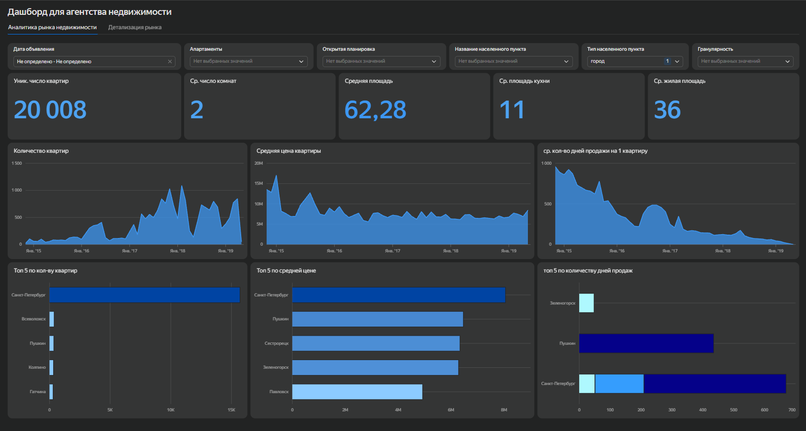
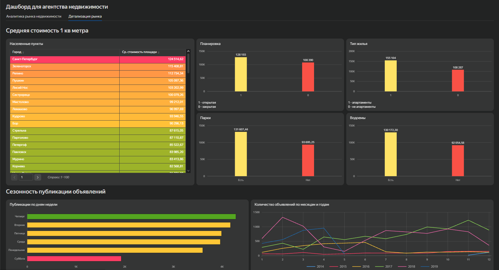

# Привет! Я Артемий, начинающий продуктовый аналитик. Учусь на 2 курсе ПМИ в СПбПУ и параллельно углубленно изучаю продуктовую аналитику в Яндекс Практикуме. Увлекаюсь поиском инсайтов в данных и превращением их в конкретные бизнес-решения.

## Технический стек
* **Базы данных:** PostgreSQL, SQL (JOINs, CTE, Window Functions, агрегации)
* **Визуализация:** Yandex DataLens
* **Анализ данных:** Python (Pandas, Matplotlib) *в процессе активного изучения*
* **Инструменты:** Git, GitHub, DBeaver, Google Sheets

---

## Мои проекты

### 1. Анализ рынка недвижимости Санкт-Петербурга и ЛО
* **Задача:** Определить самые привлекательные сегменты и сезонные тенденции для планирования маркетинговых кампаний.
* **Что сделал:** 
  - Провел ad-hoc анализ выборки из 14 000+ объявлений.
  - Выявил, что рынок СПб в 4 раза активнее ЛО, при этом средняя стоимость кв. метра выше в 1.7 раза.
  - Обнаружил четкую сезонность: пики публикаций и продаж приходятся на октябрь-ноябрь.
* **Ключевой инсайт:** Оптимальное время выхода на рынок — конец августа, чтобы захватить пик осеннего спроса. Основной объем инвестиций в рекламу следует направлять на август-ноябрь, минимизируя затраты в мае-июне.
* **Визуализация в Yandex DataLens:**

**[Посмотреть интерактивный дашборд в DataLens](https://datalens.yandex/oy3n6fgt8umq7?_share_link=public)**

### 2. Анализ монетизации и поведения игроков (RPG-игра «Секреты Тёмнолесья»)
* **Задача:** Оценить влияние характеристик игроков на покупки и найти точки роста монетизации.
* **Что сделал:** 
  - Проанализировал более 1.3 млн транзакций с помощью SQL (CTE, оконные функции).
  - Выявил, что доля платящих игроков стабильна (18%) вне зависимости от расы, но паттерны трат различаются.
  - Обнаружил, что 2 эпических предмета формируют 98% всех покупок, указывая на дисбаланс в ассортименте.
* **Ключевой инсайт:** Human совершают много дешевых покупок (121 транзакция по ~403 ед.), а Northman — реже, но дороже (82 транзакции по ~761 ед.). 
* **Рекомендация:** Внедрить таргетированные механики: для Human — скидки на объем («купи 3 по цене 2»), для Northman — эксклюзивные премиум-предложения.

---

## Связаться со мной
* **Telegram:** [@dreamoftioma](https://t.me/dreamoftioma)
* **VK:** [Тёма Столяров](https://vk.ru/dreamoftiomaa)
* **Email:** [tema.stolyarov@bk.ru](tema.stolyarov@bk.ru)
* **Резюме:** [...]
